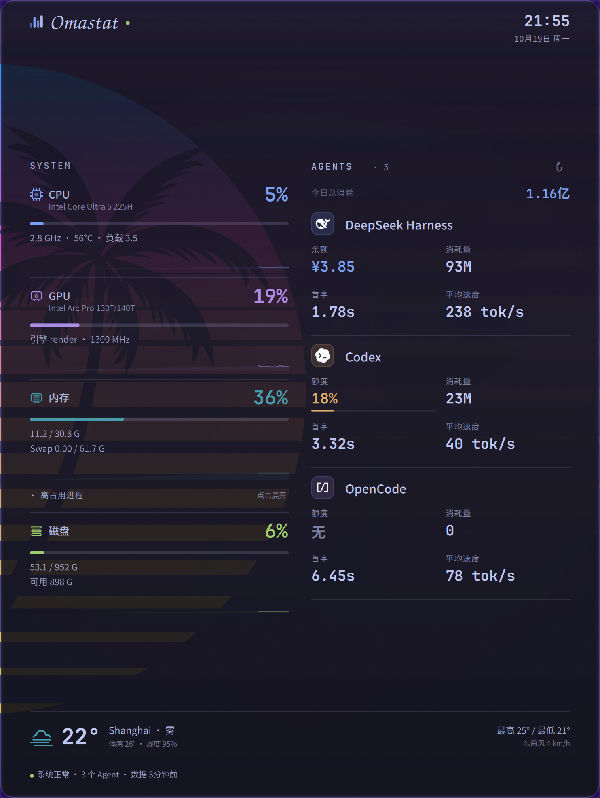
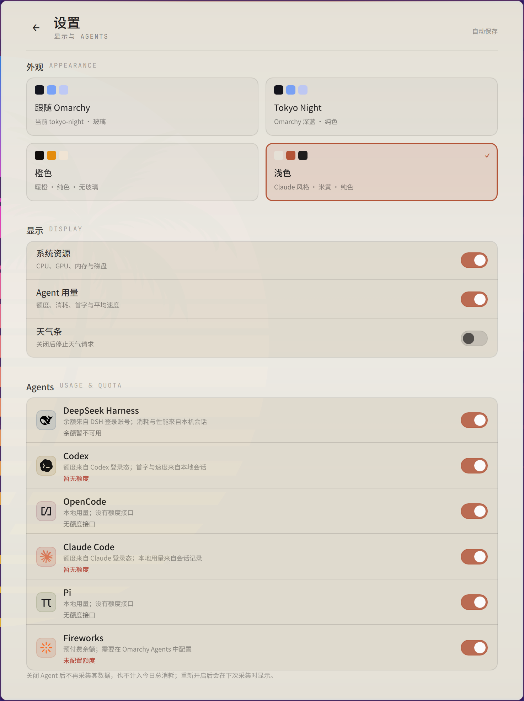

# Omastat

面向 Omarchy / Hyprland 的系统资源与 AI Agent 监控窗口。使用 Quickshell / QML 和 Python 标准库，无需 sudo 或新增后台服务。



## 功能

- **普通应用窗口**：默认不强制浮动、置顶、固定工作区、窗口位置或尺寸；由用户的 Hyprland 配置管理。支持平铺、移动、调整大小、关闭后重新显示。
- **核心指标**：CPU 型号、使用率、温度、频率与最近 60 秒趋势；GPU 型号、使用率与趋势；内存、Swap；根文件系统容量、可用空间与块设备读写速度。内存区域默认收起占用最高的三个进程；点击「高占用进程」展开名称与占总内存比例。容量单位统一显示为 `G`。缺失或不支持的数值显示 `--` /「暂无数据」。GPU 温度、显存、功耗仅显示内核提供的传感器。
- **Agent 用量**：支持 Omarchy 本机 agent usage 提供的全部 6 个工具：DeepSeek Harness、Codex、OpenCode、Claude Code、Pi、Fireworks（DeepSeek Harness 第一）。每个工具一行，固定展示四项：**额度/余额、消耗量、首字、平均速度**。DeepSeek Harness 显示 DSH 登录账号的 Platform 余额；Codex/Claude 显示本机登录态可读到的额度；Fireworks 有预付费余额时显示余额；OpenCode/Pi 没有额度接口时显示「无」。Agent 区单独显示「今日总消耗」，消耗量达到 100M 后按「亿」显示。可在设置页逐个选择展示哪些 Agent；未选择的 Agent 不采集、不计入今日总消耗。默认全部展开，不折叠、不需要点击。
- **设置页**：右上角滑杆入口，返回后回到概览。可切换主题（跟随 Omarchy / Tokyo Night / 橙色 / 浅色）、开关系统资源/Agent 用量/天气条、逐个选择 Agent，并恢复默认显示。修改自动保存到 `config.local.json`，无需重启。
- **视觉**：名称统一为 Omastat；顶部名称使用 Z003 花体英文，时间和日期同时显示；默认深色磨砂玻璃背景取自当前 Omarchy 主题壁纸，宽窗口自动两栏，窄窗口自动单栏并滚动。内置三套纯色主题：Tokyo Night（Omarchy 深蓝）、橙色（暖橙、无玻璃）、浅色（Claude 风格米黄、陶土色强调）；三套均为无壁纸、无颗粒、不透明面板，只有「跟随 Omarchy」保留玻璃效果。窄窗口下标题和时间会自动分成上下两行，时间淡入显示，避免重叠。
- **底部天气**：读取与 Omarchy 状态栏天气相同的本机位置配置（`~/.local/state/omarchy/settings/weather.json`，缺失时按 IP 自动定位）和同一个 wttr.in 数据源，显示当前温度、天气、体感/湿度、最高/最低与风向风速；每 15 分钟刷新，窗口隐藏或关闭天气条时暂停。
- **独立顶部栏入口**：点击切换同一个监控窗口；可选 CPU、内存或现有账号额度。`○` 正常、`◐` 过期、`●` 异常、`◌` 未知，异常与过期另有颜色提示。

## 主题

内置四种模式，均可在设置页即时切换并自动保存：

| `theme` | 外观 | 表面 |
| --- | --- | --- |
| `auto` | 跟随 Omarchy 当前配色 | 壁纸磨砂玻璃 |
| `tokyo-night` | Omarchy Tokyo Night 深蓝 | 纯色、不透明 |
| `orange` | 暖橙 + 暖炭黑 | 纯色、不透明 |
| `light` | Claude 风格米黄 + 陶土色强调 | 纯色、不透明 |



具名主题不读取壁纸，也不会修改 Omarchy 桌面主题或顶部栏；`auto` 是唯一跟随系统主题和保留玻璃效果的模式。主题值写在 `config.local.json` 的 `theme` 字段，也支持手动修改 `config.json`。

## 依赖与安装

本机核对版本：Omarchy 4.0.5、Hyprland 0.56.2、Quickshell 0.3.2。需要 Python 3，以及 `Noto Sans CJK SC` / `JetBrainsMono Nerd Font`。

```bash
git clone https://github.com/chencujinlin/omastat.git
cd omastat
./install.sh
omastat show
```

安装会创建应用和命令软链，安装 `chencu.omastat` 顶部栏插件，并在 `~/.config/omarchy/shell.json` 现有右侧模块之后添加入口。保留其他模块与已有 `SUPER + CTRL + M` 快捷键；若该键已被其他命令占用，则保留它。

已知旧版 `vitals.lua` 会先备份，再迁移为空规则模块；自定义规则文件保留。新窗口标题为 `Omastat`，不再匹配旧的 `^系统监控$` 规则。依据[当前 Hyprland 官方窗口规则文档](https://wiki.hypr.land/Configuring/Basics/Window-Rules/)核对：`float` 和 `pin` 是不同的行为；本项目默认都不设置。`FloatingWindow` 本身仍是普通顶层应用窗口。

更新已有实例后，运行 `omarchy-vitals quit`，再运行 `omastat show`。顶部栏配置自动热加载；窗口规则安装后执行 `hyprctl reload`，用 `hyprctl configerrors` 检查。

## 使用与配置

```bash
omastat toggle        # 显示 / 隐藏；未运行时启动
omastat hide
omastat refresh       # 刷新请求也受限流保护
omastat status        # JSON：可见性、系统状态、Agent 状态与额度
omastat quit
omastat run           # 前台运行，查看 QML 诊断
```

兼容原有 `omarchy-vitals` 命令、IPC target `vitals` 和快捷键。启动锁与 Quickshell `-n` 防止入口并发创建多个实例。

`config.json` 保存后自动读取。设置页只写入被 `.gitignore` 排除的 `config.local.json` 覆盖层，`config.json` 保持为可提交的默认值：

```json
{
  "startHidden": false,
  "refreshSeconds": 300,
  "theme": "auto",
  "showSystem": true,
  "showAgents": true,
  "showWeather": true,
  "agents": [
    "deepseek-harness",
    "codex",
    "opencode",
    "claude",
    "pi",
    "fireworks"
  ]
}
```

`output` 可选，用于选择显示器；`startHidden` 只决定首次启动状态。`theme` 为 `auto`（跟随 Omarchy、玻璃）、`tokyo-night`（固定深蓝纯色）、`orange`（固定暖橙纯色）或 `light`（固定米黄纯色）。任一无壁纸的具名主题都不读取壁纸。`agents` 为要展示和采集的 Agent 列表，空数组表示全部隐藏；默认包含 6 个 Agent，顺序固定为 DeepSeek Harness、Codex、OpenCode、Claude Code、Pi、Fireworks。`config.local.json` 是逐字段覆盖层，设置页修改主题、显示开关和 Agent 列表时写入；也支持手动覆盖 `refreshSeconds`、`output` 等其他配置键（设置页会保留这些手动键）。

顶部栏的 `chencu.omastat` 项支持 `metric`：`none`（默认，仅入口）、`cpu`、`memory`、`agent:codex`、`agent:deepseek-harness`、`agent:opencode`、`agent:claude`、`agent:pi`、`agent:fireworks`。通过 Omarchy 模块设置，或修改现有入口，例如：

```json
{ "id": "chencu.omastat", "metric": "cpu" }
```

被设置页隐藏的 Agent 不再进入 IPC 的额度列表，对应顶部栏 `agent:ID` 会显示未知；这是展示选择的一部分。

面板可见时系统按 1 Hz 采样；隐藏时停止采样和趋势积累。顶部栏选用 CPU/内存时续租同一个实例，隐藏采样降为每 5 秒；入口消失超过约 45 秒后停止该采样。顶部栏每 15 秒读取一次 IPC，不创建第二套采样器。

## 数据来源、准确性与异常状态

- 账号记录读取 `$XDG_STATE_HOME/omarchy/agents/usage/*.json`，默认 `~/.local/state/...`。优先使用 `$XDG_CONFIG_HOME/omarchy/plugins/chencu.agents/collectors/update.py`，回退到现有 `omarchy-agent-usage-update`。每个来源单独检查采集时间；最晚更新的来源不能掩盖其他来源过期。
- Agent 范围与 Tokei 对齐到本机数据源：Tokei 支持 20+ 个 Provider，但本机 Omarchy agent usage 实际只产出 DeepSeek Harness、Codex、OpenCode、Claude Code、Pi、Fireworks 六个记录；项目只展示有本地来源的 Agent，不为其他 Provider 伪造数据。
- 设置页选择 Agent 后，服务只轮询/采集选中的记录；隐藏的 Agent 不参与今日总消耗，也不出现在顶部栏额度列表。Fireworks 的预付费 `balance` 若由采集器写入则显示为「余额」，没有配置或没有余额时显示「未配置额度」，不补零。
- 每 15 秒检查记录；后台线程按来源刷新，自动失败重试至少间隔 `refreshSeconds`（最低 60 秒），手动刷新至少间隔 30 秒。单次采集限时 100 秒，并隔离失败来源；不转发上游 stderr 或原始异常正文。
- OpenCode、DeepSeek Harness、Pi 复用 `~/.cache/omarchy/agents-extension/local-tools.json` 中现有事件，不重复扫描这些日志。OpenCode 额外只读取 SQLite 分叉关系，去除已知父子会话中复制的计费事件；独立请求不合并。
- Codex/Claude 内置账号记录可能包含 Pi/OpenCode 用量，不能当作各工具独占账。项目对原生 CLI 日志使用按文件签名复用的计数缓存；Codex 累计快照取增量、跳过重复快照，Claude 流式片段按稳定消息标识去重。推理 Token 已属于输出，不再次相加；缺失的缓存分项保持未知。
- 请求次数指有真实 Token 用量记录的请求；未记录计费数据的失败尝试无法补算。工具 Token 与订阅额度分开展示，不跨工具/账号相加。今日数据使用本机时区；跨午夜重新归档，旧的今日字段不会冒充新一天数据。
- 「首字」为平均首 Token 时间（TTFT），「平均速度」为输出 Token/秒；DeepSeek Harness/OpenCode 优先使用今日数据，缺失时回退到累计数据。
- Codex 的首字/速度来自会话 JSONL：从 `task_complete` 读取 `duration_ms` / `time_to_first_token_ms`，从 `token_usage_record` 的 `turn_token_usage.output_tokens` 取该 turn 的输出量。采用与 Tokei 一致的口径：首字取今日有效 turn 的 TTFT 中位数（样本 ≤120s），速度为输出 Token 合计 ÷ 生成耗时合计，过滤过短/过长及异常速度样本；旧会话没有时序字段时不补造，显示 `--`。
- CPU 型号读取 `/proc/cpuinfo`；GPU 型号在启动时通过一次可选的 `lspci` 查询获取，失败时回退到 DRM 驱动名，不阻塞采样。
- Agent 区的「今日总消耗」为当前可见 Agent 今日 Token 之和；达到 100M 后按「亿」显示（例如 101M → 1.01亿）。
- 内存高占用进程按 `comm` 聚合 RSS，展示前三名及占总内存比例；RSS 会重复计算共享页，只用于相对排序，不等同于 PSS。
- 天气位置和结果来自本机状态栏同一份 `weather.json` 配置与 wttr.in 响应；不复制状态栏的聊天、账户或凭据。设置页关闭天气条后停止定时请求，重新开启时立即请求一次。
- 额度缓存最多保留六小时，按实际获取时间失效，并剔除已重置窗口。额度行不伪造数据。
- DeepSeek Harness 的「余额」读取 DSH 已登录账号的 Platform 额度：从 `$DSH_HOME/.credentials.yaml`（默认 `~/.dsh/.credentials.yaml`）的 `deepseek-account-platform/default` 记录取账号 grant，按 DSH 相同的客户端头请求 `{issuer}/api/v0/users/get_user_summary`，优先使用 CNY 的 normal_wallet（与 DSH 账号界面同源）。账号 grant 只作为 `x-dsh-auth-token` 请求头，不写入快照、缓存或日志；没有 DSH 登录时回退到 `DEEPSEEK_API_KEY` 对应的官方 API 余额。成功结果内存缓存 5 分钟，手动刷新会强制更新；失败显示 `--`，不伪造余额。
- 缺失文件、损坏 JSON、读取失败时保留最后有效数据，标明异常；未知值不补零。只有事件中真实时间存在时才展示最近活动。
- CPU 使用 `/proc/stat` 差分；内存为 `MemTotal - MemAvailable`；磁盘读写只读根文件系统对应块设备，避免同时累计分区与父设备。容量按 G 显示。Intel GPU 使用现有 DRM fdinfo 引擎忙碌时间估算，不等同于 `intel_gpu_top`；权限不足、不可识别设备及传感器缺失均降级。多 GPU 不混合温度/功耗传感器。

运行计数缓存位于 `$XDG_STATE_HOME/omarchy/omastat/`，只缓存记录、事件标识和计数，不保存会话正文或凭据。首次读取原生 CLI 日志的成本取决于文件数量；后续仅重解析签名发生变化的文件。没有可读原生日志时，不使用含其他工具的账号聚合数字冒充工具 Token。

## 隐私与凭据

仓库不包含 API Key、DSH 账号 grant、Cookie 或其他登录凭据。运行时的余额查询只在本机内存中使用凭据；快照、日志和 Git 提交都不写入这些值。`docs/preview.png` 是界面截图，只展示本机运行时的少量统计数字，不包含密钥。

## 检查与验证


```bash
python3 -m unittest discover -s tests -v
python3 tests/theme_smoke.py
python3 tests/config_smoke.py
python3 tests/header_smoke.py
python3 tests/qml_smoke.py
bash -n install.sh uninstall.sh bin/omarchy-vitals bin/omastat
/usr/lib/qt6/bin/qmllint -I /usr/lib/qt6/qml shell.qml Vitals.qml Config.qml services/*.qml components/*.qml
python3 scripts/vitals_sampler.py --count 2
```

单元/集成测试覆盖来源独立刷新、异常恢复、限流、跨午夜、额度 TTL/重置、Claude 认证失效回退、计费去重、TTFT/速度透传、内存进程聚合、安装配置保留、配置覆盖层合并、空 Agent 列表、6 Agent 顺序与 Fireworks 余额净化。`config_smoke.py` 用真实 QML FileView 验证设置写入、手动覆盖键保留与重启加载；`theme_smoke.py` 验证 auto、Tokyo Night、橙色、浅色四种模式的玻璃、明暗、圆角与核心色值；`header_smoke.py` 验证宽/窄窗口下标题和时间头部的重排。QML 冒烟检查覆盖应用、隐藏态应用和本机 Omarchy 顶部栏组件；真实 Wayland 窗口截图核对了四种主题、设置页宽/窄布局、头部 380/320/300 宽度、单栏和全部隐藏状态。

真实桌面实测：窗口平铺为 741×986 时 Quickshell 静态约 2% 单核；系统采样器约 3–5% 单核；隐藏窗口后采样器停止。玻璃背景使用低分辨率壁纸放大，不做全屏逐帧模糊，避免常驻 GPU 负担。

已在真实 Hyprland 桌面验证：窗口为普通平铺应用、无 layer-shell、无预留区域、无强制浮动/置顶；显示与隐藏、顶部栏入口、快捷键和采样暂停/恢复均正常。

## 目录与回退

`shell.qml` 管理窗口/IPC 与概览/设置页切换；`Config.qml` 合并 `config.json` 与 `config.local.json`；`lib/Themes.js` 登记主题与调色板；`Vitals.qml`、`components/SettingsView.qml` 和其余 `components/` 渲染界面；`services/` 对接系统采样、Agent 快照与主题；`scripts/agents_service.py` 管理来源状态、配置覆盖层和刷新；`scripts/usage_stats.py` 负责计数；`scripts/vitals_sampler.py` 提供系统采样；`bar/` 为独立顶部栏模块；`tests/` 为验证入口。图标来源与许可证见 `assets/agents/NOTICE.md`。

```bash
./uninstall.sh
```

卸载移除项目入口和本次添加的模块，不删除源码；保留其他顶部栏模块。修改配置前会生成 `.bak.*` / `.bak.omastat.*`，可按对应文件备份恢复；已迁移的旧窗口规则也有安装元数据用于恢复。安装/卸载前会为改动过的 Hyprland 与顶部栏配置文件生成 `.bak.*` 备份。
